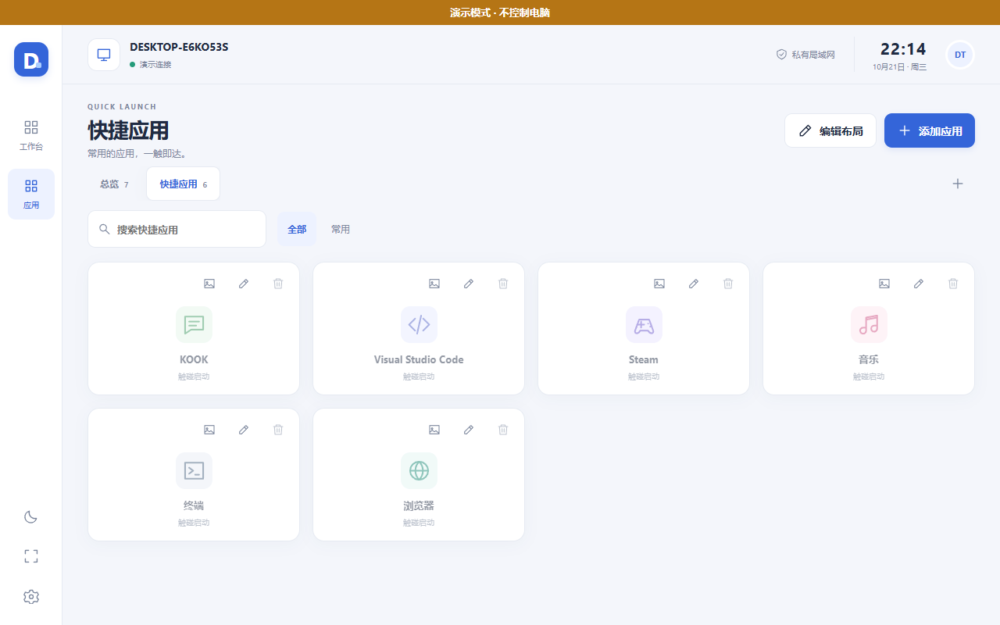
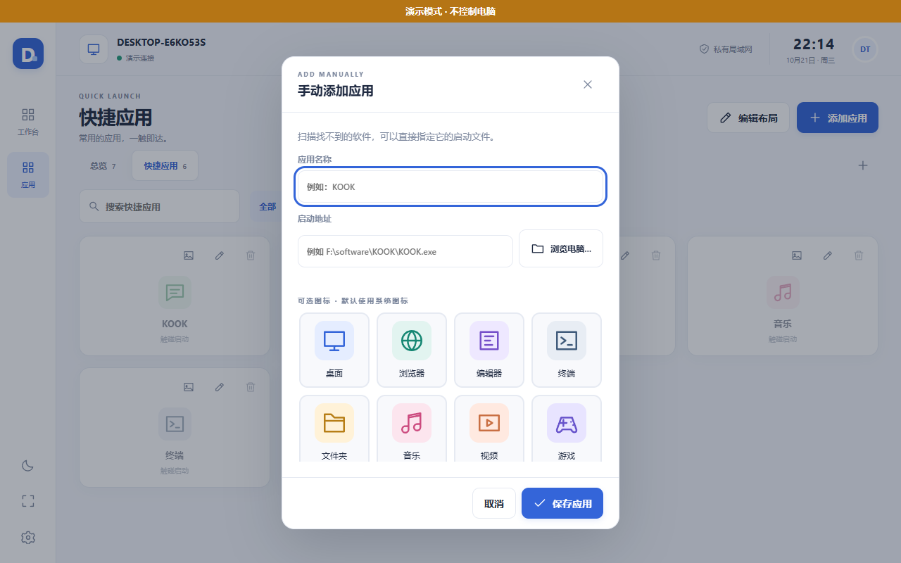
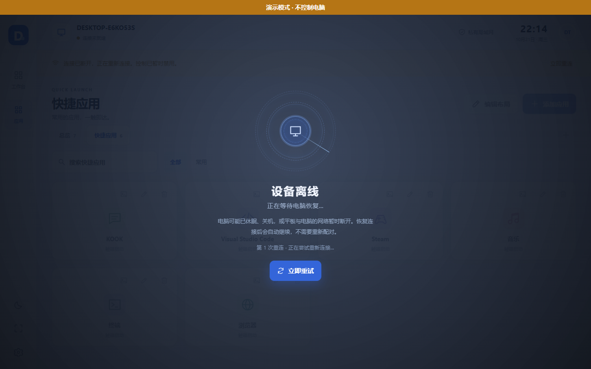

# DeskTouch（桌触）

把一台闲置的安卓平板变成 Windows 电脑的局域网控制面板。平板打开网页，点一下就启动电脑上的软件、调音量、看 CPU/内存/磁盘、控制播放器、锁屏或关机。

不需要云服务，不需要公网 IP，不需要装 App——电脑跑一个本地服务，平板用浏览器访问。

**当前版本：1.1.2** · Windows 10/11 x64 · Python 3.11+

---

## 界面预览

| 快捷应用 | 手动添加应用 |
|---|---|
|  |  |

电脑休眠或断网时，整屏切换为等待状态，恢复后自动回到面板：



---

## 为什么做这个

闲置平板吃灰，而现成的遥控工具要么收费、要么只能当鼠标用、要么必须装客户端。DeskTouch 的思路是：**电脑端只提供网页，平板端什么都不用装**。

- 浏览器打开就能用，老平板也能跑（前端限制在 ES2017，零外部 CDN）
- 所有能力都在本地局域网，数据不出内网
- 配置驱动：面板是「页面 + 卡片」结构，可自己加页面、调跨列、换主题

---

## 功能特性

### 应用控制
- **四来源自动发现**：系统/个人开始菜单快捷方式、Microsoft Store 应用、Steam 库、当前有窗口的进程
- 搜索、按来源筛选、多选、批量添加、重复添加保护、扫描结果缓存
- **手动添加**：扫描没找到的软件，填名字、挑图标、逐级浏览磁盘目录选中目标
- **Electron 类软件自动修正**：KOOK / Discord / VS Code 这类把真实程序放在 `app-<版本>` 子目录的，启动前自动解析到正确路径
- 支持 `exe` / 快捷方式 `.lnk` / 文件夹 / 文件关联 / UWP（AUMID）/ URI 协议 / 本地命令行
- 已运行时尝试把窗口切到前台；同目标并发启动加锁

### 系统状态
- CPU 使用率（60 点历史曲线）、内存、磁盘、网络速率、运行时长
- 当前前台窗口进程与标题
- 电池状态（笔记本）

### 音量与媒体
- 主音量滑块与静音，外部改变实时同步
- 没有可用声卡时明确显示不可用，不伪装成功
- 读取 Windows SMTC 的曲目、艺术家、专辑、封面、播放进度，支持播放/暂停/上一首/下一首

### 电源
- 锁定、关闭显示器、睡眠、重启、关机
- 全部先弹警告，再长按 1.5 秒确认，服务端校验一次性凭证
- 不会强制结束未保存的程序

### 面板体验
- 多页面、新建页面、添加状态卡片、左右移动与跨列编辑
- 浅色/深色主题、自定义强调色、全屏
- 断线指数退避重连，配置热重载
- 20 个原创本地 SVG 高清图标，可随时更换或恢复系统图标
- 电脑离线时全屏等待动画 + 一键重试

### 桌面端
- 无 CMD 窗口，关闭窗口只隐藏到系统托盘
- 连接窗口显示局域网地址、二维码、6 位配对码
- 默认随当前用户登录自启（可关闭，偏好持久化）
- 重复启动会唤醒已有实例，不会开第二个服务

---

## 工作原理

```
┌──────────────┐   HTTP + WebSocket   ┌───────────────────────────┐
│  安卓平板     │ ───────────────────► │  Windows 电脑              │
│  浏览器       │                      │                           │
│              │ ◄─────────────────── │  FastAPI + uvicorn        │
│  web/ 前端   │   每秒推送快照        │  ├─ 鉴权 / 配对            │
└──────────────┘                      │  ├─ 应用扫描与启动         │
                                      │  ├─ 音量（pycaw）          │
                                      │  ├─ 媒体（WinRT SMTC）     │
                                      │  ├─ 系统状态（psutil）     │
                                      │  └─ 电源（一次性凭证）     │
                                      │                           │
                                      │  数据目录（本地）          │
                                      └───────────────────────────┘
```

- 电脑端只监听**回环地址或私有局域网 IPv4**，不监听 `0.0.0.0`
- 网页通过 WebSocket 首帧提交令牌鉴权，不把令牌放进 URL
- 长期设备令牌在磁盘上只保存 SHA-256 哈希

---

## 环境要求

| 项目 | 要求 |
|---|---|
| 系统 | Windows 10 / 11 x64 |
| Python | 3.11 及以上（开发与测试用 3.13） |
| 必需 | tkinter（Python 官方安装包默认包含；精简版/conda 精简环境可能缺失） |
| 网络 | 电脑与平板在同一局域网，能互相访问 |

Linux / macOS 不受支持：音量、媒体、UWP、电源都依赖 Windows API。

---

## 快速开始

### 1. 获取代码

```bash
git clone https://github.com/Yang-k955/DeskTouch.git
cd DeskTouch
```

### 2. 安装依赖

建议用虚拟环境：

```powershell
python -m venv .venv
.venv\Scripts\activate
pip install -r requirements.txt
```

### 3. 启动

```powershell
python DeskTouch.py
```

或直接双击 `start.bat`（会自动找 `pythonw` 后台启动，不留黑窗口）。

启动后弹出连接窗口，显示：

- 局域网地址（形如 `http://192.168.1.20:8000`）
- 二维码
- 6 位配对码（10 分钟有效）

### 4. 平板连接

1. 确认平板和电脑连同一个 Wi-Fi
2. 平板浏览器打开窗口里的地址，或扫码
3. 输入配对码
4. 之后同一浏览器、同一地址会自动连接，不用再输

### 5. 添加应用

点「添加应用」→ 勾选扫描结果 → 批量加入「快捷应用」页。

扫描没找到的，点「手动添加」：填名字 → 选图标 → 浏览电脑目录选中 exe。

---

## 打包为可执行文件

需要 PyInstaller：

```powershell
pip install pyinstaller
pyinstaller DeskTouch.spec
```

产物在 `dist/DeskTouch/`。**必须保留整个文件夹**，`DeskTouch.exe` 旁边的 `_internal` 是运行时和网页资源，只拿走 exe 会启动失败。

> 注意：精简版 Python 如果没有 tkinter，PyInstaller 会报 `tkinter installation is broken`。请用带 Tcl/Tk 的官方安装包。

---

## 命令行参数

| 参数 | 说明 |
|---|---|
| `--host <ip>` | 指定监听地址。默认 `lan`（自动挑选最佳私有网卡）；也可传具体 IP |
| `--port <n>` | 指定端口，默认 8000 |
| `--data-dir <path>` | 指定数据目录，覆盖默认位置 |
| `--demo` | 演示模式：只读模拟数据，不执行任何真实控制，界面显著标识 |
| `--background` | 仅启动托盘，不弹连接窗口（自启时使用） |
| `--headless` | 纯服务端模式，不创建窗口和托盘（调试用） |
| `--no-autostart` | 不读取也不写入开机自启 |

演示模式适合先看效果：

```powershell
python DeskTouch.py --demo
```

---

## 配置与数据

默认数据目录：

```
%LOCALAPPDATA%\DeskTouch\data\
├── config.json        面板布局、页面、应用白名单
├── state.json         已配对设备（只存令牌哈希）
├── scan_cache.json    扫描结果缓存
├── desktop.json       托盘与自启偏好
├── location.json      用户手动选择的旧数据目录
├── icons\             系统图标缓存
└── logs\desktop.log   托盘日志
```

- 换 exe 位置不会丢数据
- `--data-dir` 或环境变量 `DESKTOUCH_DATA_DIR` 可以改位置
- 从旧版本升级时，会把仍然有效的旧令牌转为长期有效；已过期的不会复活

> `state.json` 是敏感文件，等同于你所有已配对设备的通行证。备份就备份整个 `data` 目录，不要公开分享。

---

## 局域网与防火墙

程序只选一个 RFC1918 私有地址（`10.x` / `172.16-31.x` / `192.168.x`），**不支持公网，也不会监听 `0.0.0.0`**。

### 地址选错了

如果连接窗口显示 `172.17.x.x`、`172.20.x.x` 之类地址，通常不是你的局域网 IP，而是 WSL、Docker 或 Hyper-V 的虚拟网卡，平板访问不到。

程序会按下面这个顺序打分，把真实可用的地址排在最前：

- 默认路由地址 +60
- 与默认路由同网段的物理网卡 +50
- 物理网卡 +40
- 网卡已连接 +15
- 虚拟网卡（vEthernet / WSL / Docker / Hyper-V / VMware / VirtualBox / TAP / Tailscale / ZeroTier）−60

仍不对的话，在连接窗口的下拉框改选真实网卡，选择会被记住。保存的地址消失时（拔网线、换 Wi-Fi）会回退到可用地址并提示。

也可以直接指定：

```powershell
python DeskTouch.py --host 192.168.1.20 --port 8000
```

### 防火墙

首次运行时 Windows 会询问，**只允许「专用网络」**。

程序不会替你改防火墙。如果没弹窗，手动为程序或 TCP 8000 端口建一条只允许本地子网的入站规则。

路由器如果开了「访客隔离 / AP 隔离」，平板和电脑会互相看不见，需要关掉或换到同一个可互访的网络。

### 加密

局域网内走 HTTP，**不加密**。配对码和令牌都在内网明文传输，无法防止同网段主动窃听。只在可信 Wi-Fi 使用，不要做端口映射暴露到公网。

---

## 安全设计

| 措施 | 说明 |
|---|---|
| 监听范围 | 只绑回环或私有 IPv4，拒绝 `0.0.0.0` 和公网地址 |
| 配对 | 6 位随机码，10 分钟有效，失败限流 |
| 令牌 | Bearer token，磁盘只存 SHA-256 哈希，可显式撤销 |
| WebSocket | 连接后首帧提交 `{type:"auth",token}`，不把令牌放 URL |
| 请求校验 | 校验 Host、Origin 与来源 IP，防 DNS rebinding 与跨站调用 |
| 应用启动 | 手机端只能提交候选键或应用 ID；手动添加的路径由服务端分类校验，拒绝 UNC、相对路径、非白名单扩展名 |
| 电源操作 | 必须长按 1.5 秒，服务端校验一次性凭证，过期即失效 |

**做不到的事**：局域网 HTTP 不加密；不防同一台电脑上的恶意程序；不替代 Windows 账户权限。

---

## 常见问题

### 双击 exe 报 `Failed to load Python DLL ... python313.dll`

说明你运行的 exe 旁边没有 `_internal` 文件夹。常见于：

- 只把 `DeskTouch.exe` 单独拷了出来
- 点到了 PyInstaller 的中间产物 `build\` 目录里的 exe

请运行 `dist\DeskTouch\DeskTouch.exe`（或发布包里解压出来的同名文件），并保留整个文件夹。

### KOOK / Discord / VS Code 点击启动报「工作目录不存在」

这类软件用 Electron 打包，安装目录里的 `KOOK.exe` 常常只是占位启动器，真实程序在 `app-0.109.1\KOOK.exe` 这样的版本子目录，快捷方式里还可能残留旧版本的工作目录。

从 1.1.2 起程序会自动处理：目标文件不存在时，在同级 `app-<版本>` 子目录里找同名 exe 并取版本号最大的；工作目录失效时回退到真实程序所在目录。

程序不会瞎猜——如果同级目录里没有能确定的真实程序，会如实报错，而不是随便启动一个文件。

### 平板打不开页面

按顺序排查：

1. 电脑和平板是否在同一 Wi-Fi（不是手机热点、不是访客网络）
2. 地址是不是虚拟网卡 IP（见上文「地址选错了」）
3. Windows 防火墙是否放行（只允许专用网络）
4. 路由器是否开了 AP 隔离
5. 电脑休眠或关机了没有

### 换地址、清缓存后要重新配对

配对记录存在浏览器的 localStorage 里，绑定「协议 + IP + 端口 + 浏览器」。以下情况必须重新配对：

- 电脑 IP 变了
- 换了端口
- 清了网站数据
- 用了无痕窗口
- 换了浏览器或设备

建议在路由器里给电脑固定 DHCP 地址。

### 平板熄屏后页面断开

HTTP 局域网通常不满足安装式 PWA 和 Wake Lock 的安全上下文要求，网页无法强制常亮。请用平板系统的「屏幕常亮」设置，或把网页添加到主屏幕。

### 音量 / 媒体显示不可用

说明当前没有可用声卡或没有活跃的播放器。程序会显示真实错误，不会假装成功。

---

## 项目结构

```
DeskTouch/
├── DeskTouch.py            程序入口（桌面托盘模式）
├── DeskTouch.spec          PyInstaller 打包配置
├── start.bat               源码启动脚本
├── requirements.txt        依赖清单
├── server/                 后端
│   ├── main.py             FastAPI 应用、路由、WebSocket
│   ├── desktop.py          托盘、连接窗口、单实例、自启
│   ├── auth.py             配对、令牌、限流
│   ├── config.py           面板与应用白名单配置
│   ├── storage.py          数据目录解析与迁移
│   ├── launcher.py         应用启动与目标解析
│   ├── scanner.py          四来源软件扫描
│   ├── browser.py          目录浏览与路径校验
│   ├── icons.py            系统图标提取与缓存
│   ├── icon_library.py     20 个内置矢量图标
│   ├── audio.py            音量控制
│   ├── media.py            媒体信息与播放控制
│   ├── monitor.py          系统状态采样
│   ├── power.py            电源操作
│   ├── network.py          网卡打分与选择
│   └── hub.py              WebSocket 广播
└── web/                    前端（无构建步骤，改完刷新即可）
    ├── index.html
    ├── app.js
    ├── style.css
    ├── manifest.json
    ├── sw.js
    └── icon*.png / icon.svg
```

前端刻意保持零依赖、零构建：不用框架、不用打包器、不用 CDN，所有 DOM 操作走 `textContent`，不拼 `innerHTML`。

---

## 版本历史

| 版本 | 主要变化 |
|---|---|
| **1.1.2** | 修复 Electron 类软件（KOOK 等）`app-<版本>` 目录与失效工作目录导致的启动失败；卡片操作改为三个小图标并支持修改启动地址；新增手动添加应用与目录浏览；断线改为全屏等待动画 |
| 1.1.1 | 修复局域网地址误选 WSL/Docker/Hyper-V 虚拟网卡，新增网卡打分与手动选择 |
| 1.1 | 长期设备令牌与稳定数据目录；无 CMD 托盘与默认登录自启；20 个本地 SVG 图标与更换界面 |
| 1.0 | 首个可用版本：扫描、白名单启动、音量、状态、媒体、电源、多页面布局 |

---

## 已知限制

- 只在 Chromium 内核浏览器验证过（1280×800 横屏与 390px 竖屏），未覆盖所有安卓 WebView 版本
- HTTP 明文传输，仅限可信局域网
- 不自动修改防火墙
- 单应用音量、输出设备切换、GPU 温度、触控拖拽排序、强制关闭软件尚未实现
- Windows 的防抢焦点策略或全屏应用可能阻止窗口激活，此时只提示「已在运行」，不会用 Alt 键绕过系统策略
- 「启动成功」只代表进程已拉起，不代表目标窗口一定出现

---

## 许可

[MIT](LICENSE)

---

## 说明

本项目为个人自用工具，按现状提供。涉及电源操作的功能请自行确认风险，重要工作请先保存。
